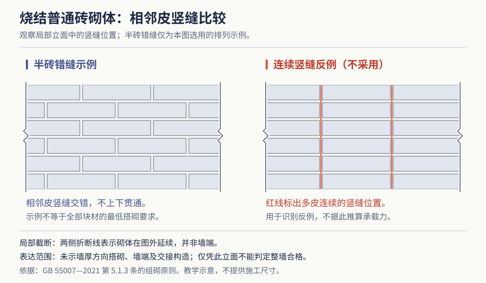

# 砌体结构

从[墙体类型](/lesson/basics/wall/wall-types.html)进入本节，先把单块材料放回整栋建筑：楼板由谁承托？再缩小到墙交接：块材怎样搭接，水平与竖向构件怎样形成整体？布置模型与连接模型分别回答这两个尺度的问题。

## 承重墙布置与传力

砌体由块材和砂浆等组成，材料抗压性能较好，而抗拉、抗剪及变形能力受到限制。其结构布置应使作用传递明确，纵横墙形成必要联系，墙体在竖向尽量连续，避免突然取消下层支承或形成明显薄弱部位。

横墙承重方案中，楼板主要支承在横墙上。横墙间距较小时，楼板跨度较易控制，房间常重复排列，适合空间分隔比较明确的建筑；较多的承重横墙也限制房间合并和以后改动。纵墙承重方案中，楼板主要支承在纵墙上，横向空间分隔较灵活，但需要保证横向稳定和必要的横墙联系，外墙洞口也受承重要求约束。纵横墙混合承重根据不同房间的跨度和布置共同传力，空间安排较灵活，同时须协调两向墙体与楼板支承。

这些方案必须结合楼板类型和传力方向判断。预制板的支承方式不能直接套用于所有现浇双向板。底部框架、上部砌体或内框架与外承重墙结合的体系，存在刚度、变形和传力转换问题，属于需要专门设计的结构类型；不能因为底层需要商店大空间，就自行抽掉承重墙加几根柱。

四种布置按同一顺序比较：先看楼板排列和板端，接着找墙或梁，再判断是否经过内部柱列，最后在草图上补出下部基础。半框架模型有内部梁柱和外围墙体，不能把它理解为任意抽掉横墙后的临时加固。各模型中的墙体与楼板多按整组建模，点选用于识别组的角色，不能据此声称每一面墙具有相同受力身份。

先对照横墙方案的平面图与模型，找到重复横墙、通道梁和右端板带；再展开纵墙、纵横墙及半框架方案逐一比较。纵横墙方案要按不同房间读取板带排列，半框架方案要继续追到内部柱列。图中的排列线帮助定位板带，实际支承和受力方向仍需结合楼板类型与结构图判断。

## 块材、砂浆和砌体性能

砖可以按原料分为黏土、页岩、煤矸石等制品，按形态分为实心、多孔、空心制品，按工艺分为烧结和非烧结制品。原料、孔型、孔洞方向和强度共同影响适用范围，不能只凭“空心”二字判定承重或非承重。传统实心黏土砖便于加工和砌筑，但其取土、烧制能耗和较大自重也是墙材改进的重要背景。

混凝土小型空心砌块、轻骨料砌块与加气混凝土砌块具有不同的材料结构、密度和吸水、收缩特性。密度等级用于说明材料的质量特征，强度等级用于说明相应试验条件下的力学性能，二者不能相互代替。砖、混凝土砌块等常见强度标识中可见 MU，砂浆强度标识中可见 M；不同产品应按各自的等级体系识别，不能把所有墙材统一套用同一组等级。

砌筑砂浆把块材连接为整体，并找平接触面、使传力较均匀；饱满的灰缝还有助于减小漏风、渗水和漏声通道。水泥砂浆、含石灰等成分的混合砂浆，以及配套的专用砌筑砂浆，各有适用条件。砂浆选择除强度外，还应兼顾保水、和易性、块材吸水性能及使用环境。不能认为砂浆越硬越好，也不能只提高砂浆强度而忽略灰缝质量。

砌体强度由块材、砂浆、组砌、灰缝和施工质量共同决定，不等于砖与砂浆强度的平均值。块材接触不平、灰缝厚薄不均，会使受力不均匀；竖向通缝和转角咬合不足，会削弱整体联系。材料进场、储存、施工含水状态及养护，也会影响最终墙体性能。

> [!易错] 砌体强度不等于砖与砂浆强度的平均值。它由块材、砂浆、组砌、灰缝和施工质量共同决定；接触不平、灰缝厚薄不均会使受力不均匀，竖向通缝和转角咬合不足会削弱整体联系。

## 组砌方式、墙厚与模数

组砌指块材在墙内的排列。基本要求是横平竖直、上下错缝、搭接合理和砂浆饱满。砖的长面朝外称顺砖，端面朝外称丁砖。全顺、一顺一丁、梅花丁、三顺一丁等组砌方式，通过不同丁顺组合联系上下皮及墙厚方向的砌体。清水墙还要兼顾立面纹理，但美观不能替代内部可靠搭接。

对照图2-17“砖墙组砌名称”，在模型中分别点选顺砖、丁砖与砂浆：顺砖露出长面，丁砖露出端面；沿每皮砖水平延伸的是横缝，相邻砖端之间的是竖缝。观察上下皮的竖缝错开位置，并将砖的方向与灰缝的方向分别记录。原图未标注砖规格、墙厚、灰缝宽度或砂浆强度，模型分解用于识别位置关系。

**同题节点：**[辨认顺砖、丁砖、横缝与竖缝。](/#/node/brick-wall-bond-names-01)

砖的放置姿态与丁顺排列是不同分类。平砌通常将砖的大面卧放，侧砌或立砌则采用侧立等姿态，识图时应看清承压面及与邻砖的关系。传统斗砌可利用侧立砖等围合形成空腔，并与相应拉结或平砌部分组合；其整体性和承重用途应按具体设计判断，不能把带空腔的斗砌等同普通实砌承重墙。

传统普通砖以长、宽、厚约为 240、115、53 mm 的规格为典型例子。配合灰缝后，可形成半砖、一砖、一砖半、二砖等墙厚，习惯称呼中的“12 墙”“24 墙”“37 墙”，不都等于材料净厚度的精确数值。例如该规格半砖墙的块材宽度为 115 mm，一砖半墙按相应灰缝组合可形成约 365 mm 的砌体厚度。图纸应区分砌体厚度、饰面完成厚度和定位尺寸。

砌块尺寸与灰缝可按模数协调。例如名义尺寸为 400 mm 的方向，可能采用 390 mm 块材配合 10 mm 灰缝；这只是普通厚灰缝系统的读图例子。采用薄灰缝专用砂浆等系统时，不能照搬该灰缝尺寸。洞口位置、墙段长度和转角交接宜在排块图中协调，尽量减少不合理切块。对孔砌筑的空心砌块，还须使需灌芯的孔道连续。

墙体转角、丁字交接及临时间断部位应保持设计要求的咬合或拉结。错缝不足不是任意加一片钢筋网就能补救的问题，需要按材料和受力确定补强构造。洞口与结构构件的标高、支承宽度也应在排块时统筹，以免现场随意塞砖或留下薄弱窄条。

## 空心砌块墙的孔洞与错缝

对照图2-5“空心砌块墙”，先从顶部开口辨认单块砌块内部的孔洞与块壁，再沿墙面比较上下皮的竖缝位置。模型将墙体合为一组，可整体点选并旋转观察，不逐块拆分。

顶部孔洞与墙面错缝分别说明材料内部形态和组砌排列。原图未标注尺寸、材料等级、配筋或灌芯信息，不能仅凭孔洞认定已经灌芯或具备相应承载性能。

**同题节点：**[整体观察空心砌块墙的孔洞、块壁与错缝。](/#/node/hollow-block-wall-01)

## 空心砖墙的空腔与拉结

图2-4“空心砖墙”展示普通砖通过组砌围合形成空腔的局部转角。对照模型依次点选侧砌普通砖、横向拉结砖与转角平砌砖，沿顶部开口追踪空腔边缘，再比较跨腔处和两向墙交接处的排列。这种组砌空腔与单块材料内部的孔洞属于不同尺度，不能仅凭“空心”名称将两者等同。

原图未给砖规格、墙厚、拉结间距或性能数据；图模用于识别排列和位置关系，整墙承载、拉结及热工性能仍需完整资料。

**同题节点：**[观察空心砖墙的侧砌、横向拉结与转角。](/#/node/hollow-brick-wall-01)

## 圈梁、构造柱与芯柱

圈梁是沿墙体水平方向设置、把相关墙段联系起来的构件，构造柱则沿竖向在规定位置加强墙体联系。二者与墙体共同形成约束体系，提高整体性和抗倒塌能力，并有助于减轻局部变形损伤。它们不能替代缺失的承重墙，也不能把普通砌体房屋自动变成钢筋混凝土框架。

配套构造柱图把立面与1—1横剖面对应起来：沿纵横墙追踪拉结筋，在柱核内区分4个柱纵筋剖切点与围合它们的箍筋，再回到模型观察墙体、马牙槎、钢筋和圈梁的空间联系。图示配筋属于这一构造实例。

圈梁应具有连续的传力路径，转角和交接处钢筋应可靠连接。门窗洞口切断圈梁时，需要按设计形成附加圈梁等绕接构造；圈梁与过梁合并时，也要同时满足各自承担的作用。圈梁不是永远不受弯的“装饰腰带”，其截面、配筋、锚固与必要的验算均应适合实际受力。

砌体结构构造柱常位于转角、墙体交接、较大洞口两侧等需要增强联系的位置。典型施工顺序是先砌墙、后浇筑构造柱，墙端形成马牙槎并配置拉结，使混凝土柱与砌体紧密结合。构造柱与圈梁、基础的连接应连续可靠。框架柱则是主体承重骨架的一部分，按其承担的作用设计，两者的受力身份和施工顺序不同。

空心砌块墙中，可在规定孔洞内配置钢筋并灌注混凝土形成芯柱。芯柱利用砌块孔腔形成竖向增强构件，与在墙端另留截面后浇筑的构造柱具有不同的施工条件；孔道清理、钢筋连续、灌注密实和与水平构件的连接直接影响质量。位置、数量和配筋都应结合结构条件确定。

芯柱图分别表达转角与T形交接。沿上下皮砌块的孔口与壁肋追踪纵筋和灌孔位置，区分被砌块遮挡的部分与可见钢筋，再到模型中定位墙体、钢筋和灌芯。图中分开显示的两皮用于说明组合关系，不能把示意间距当成实际灰缝，也不能由局部可见钢筋推定完整锚固。

> [!注意] 本节芯柱模型和用户原图中的“C15”是原始资料标注，不能直接作为现行设计取值。GB 55007—2021第3.3.2条对混凝土砌块砌体灌孔混凝土要求不低于Cb20，且不低于块体强度等级的1.5倍。在GB 55002—2021第5.5节适用的砌体结构房屋中，还须满足第5.5.11条对芯柱等构件混凝土不低于C25的要求，不能只检查灌孔材料的一项下限。Cb与C的材料标识不在此处擅自换算。原图“2Φ12”也只是该实例的钢筋记录，不能据此确定钢筋牌号或通用配筋；现行材料与构造应按实际设计核定。[灌孔材料条文](https://gf.cabr-fire.com/m/article-39239.htm) · [砌体房屋抗震条文](https://gf.cabr-fire.com/m/article-39119.htm)

比较两种竖向增强时，先保持模型组装态找柱与墙的位置，再展开观察。构造柱侧重墙交接与边界的咬合和拉结；芯柱强调孔道、钢筋与灌芯的连续。屏幕能看到钢筋并不代表已证明锚固充分，连接长度和施工条件仍要回到详图核实。

## 从模型回到排块图

把本节的支承箭头、圈梁路线和竖向增强位置画在同一张草图上，再把洞口与排块边界加进去。需要回顾单块孔型时，返回[墙体的类型](/lesson/basics/wall/wall-types.html)；需要判断面外连接和顶部变形时，继续学习[隔墙](/lesson/basics/wall/wall-partition.html)。

## 常见错误与自测

常见错误是只提高砂浆等级而忽略灰缝质量，以碎块随意补洞，未协调排块便开槽，以及把圈梁或构造柱当作允许任意削弱砌体的补救措施。

1. 块材很强，砌体为什么仍可能较早开裂？
2. 排块图应包含哪些关键边界？
3. 同一砌块能否直接用于承重墙和隔墙？
4. 纵横墙承重是否说明每块楼板都按双向板传力？
5. 为什么构造柱和芯柱应按“位置—连接—施工”比较，而不能只比较混凝土用量？

参考答案：①连接、错缝、灰缝、偏心和约束条件都会影响共同工作。②排块应包含墙端、转角、洞口、支承、构造柱、拉结及设备预留。③用途须由产品性能和结构设计共同确定。④不是；应按各房间的板型、支承与排列分别判断。⑤两者形成增强的部位和施工条件不同，是否有效取决于连续连接、灌注及与墙体共同工作，不能由材料用量代替。

设计与施工要求可从[《砌体结构通用规范》GB 55007-2021 官方书库目录](https://ebook.chinabuilding.com.cn/zbooklib/bookpdf/probation?SiteID=1&bookID=146962)的材料、设计、施工及验收章节继续查阅。

[返回墙体目录](/lesson/wall/index.html)
